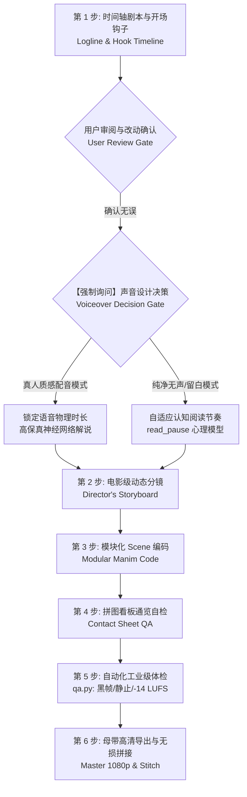

# 电影级数学视频全流程制作指南 (Manim Video Skill 2.1)

## 适用场景

当用户提出以下需求时加载并执行此 Skill：
- **制作数学可视化与科普视频**：微积分、线性代数、几何证明、概率统计、数论或物理数学动画。
- **高质感科普动画片**：将抽象晦涩的数学命题转化为好莱坞纪录片级直观叙事，融合 3Blue1Brown 直觉与多元艺术媒介质感。
- **Manim 代码编写、调试与工业体检**：编写严谨防出界、中文友好、声画毫秒级咬合、通过工业级 QA（-14 LUFS）的成片工程。

---

## ⚡ 核心哲学：导演级六步闭环制作工作流

视频质量的评价核心顺序为：**声音 (Sound) $\rightarrow$ 节奏 (Rhythm) $\rightarrow$ 镜头运镜 (Camera) $\rightarrow$ 导演调度 (Directing)**。



### 第 1 步：时间轴剧本与开场钩子（【强制】用户审核门控）
> ⚠️ **硬性红线**：严禁在未输出时间轴字幕脚本、或用户尚未确认的情况下直接开始编写 Manim 代码！
1. 确定视频主题、受众与 **1 个核心 Aha! 顿悟点**。
2. **设计前 2 秒动态钩子 (Hook)**：必须由动态几何冲突、反直觉悖论或正在形变的几何体开场，**严禁居中大标题淡入**！
3. 使用 `templates/script_timeline_template.md` 编制逐幕时间轴表格，包含：时间戳预估、口播台词（下压英文斜体小字）、对应视觉画面与动态行为。
4. **输出给用户审阅**：用户确认无误后方可进入后续环节。

### 第 1.5 步：【强制询问】声音工程决策 (Audio Decision Gate)
> 🎙️ **向用户发起明确提问**：
- **询问内容**：“台词与脚本已确认。请问本视频是否需要生成真人质感 TTS 语音配音（本地 VoxCPM2 48kHz 沉稳男声 / 微软云扬播音级男声 / 晓晓知性女声）？是否混入优雅舒适的环境 BGM 衬底？还是保持纯净无声教学模式？”
- **若选择人声配音**：声明 `ENABLE_VOICEOVER = True`，动画时长毫秒级锁死配音实际时长；
- **【硬性红线】全片音色单一性**：无特殊多角色演绎需求，**全片所有分幕（Act 1 ~ Act N）必须严格使用完全相同的单一音色与引擎贯穿始终**，杜绝音色跳变与质感割裂！
- **若选择纯净无声**：保持 `ENABLE_VOICEOVER = False`，调用 `self.read_pause(text)` 依据中文字数心理认知模型自适应留白。

### 第 2 步：电影级动态分镜设计 (Director's Storyboard)
1. 使用 `templates/storyboard_template.md` 细化分镜。
2. 拆分为 **3 ~ 5 个独立分幕 (Scenes)**，每幕独立为一个 Scene 类。
3. 遵循 **“不剪，变”** 原则：通过形变（Morphing）、推镜穿越（Zoom-through）或泛洪遮罩实现幕间转场，杜绝生硬硬切。
4. 规划每部片至少 1 个**标志性镜头 (Signature Shot)**（如微观到宏观的尺度拉远 Scale Reveal）。

### 第 3 步：模块化 Manim 编码
1. **媒介艺术主题选择**：
   - 经典暗黑几何：`"3b1b_dark"`
   - 剑桥学刊象牙米纸：`"claude_light"`
   - 工程蓝图机械制图：`"blueprint"`
   - 东方算经宣纸水墨：`"ink_wash"`
   - 现代主义网格平面：`"swiss_modern"`
   - 常春藤大学黑板粉笔：`"chalkboard"`
2. **导演语法调用**：
   - 公式认知留白：`self.read_pause("公式或台词")`；
   - 顿悟前真静音蓄力：`self.real_silence(1.2)`（无声胜有声，纯净无杂音思考聚焦）。
3. **安全视口与布局守卫**：
   - 严格保留在视口内（$X \in [-6.0, 6.0]$，$Y \in [-3.2, 3.2]$）；
   - 随时调用 `self.scan_collisions()` 检测元素碰撞重叠。

### 第 4 步：九宫格拼图看板通览自检 (Contact Sheet QA)
> 📸 **汲取 Xiaoma-Studio 核心精髓：先看拼图再出片！**
1. 无需整片反复重播，使用极速切片拼图脚本：
   ```bash
   # <SKILL_DIR> = 本 skill 的 base directory（加载时由 loader 告知的绝对路径）
   python "<SKILL_DIR>/scripts/contact_sheet.py" --video out/preview.mp4 -n 9 -o out/contact_sheet.png
   ```
2. 一眼通览全片 9/12 宫格：检阅全片色彩一致性、文字视觉层级、公式是否贴边出界。

### 第 5 步：工业级全自动体检 (Automated QA Audit)
1. 运行 `qa.py` 自动化体检：
   ```bash
   # <SKILL_DIR> 同上
   python "<SKILL_DIR>/scripts/qa.py" out/video.mp4
   ```
2. 自动化体检四道防线：
   - **黑帧检测**：0 处未解释的渲染丢失黑帧；
   - **卡死检测**：0 处超过 3 秒的无响应死帧；
   - **响度审计**：集成响度严格保持在 **-14 LUFS**（容差 $\pm 2$ dB）；
   - **规格审计**：标准 1080p 分辨率与稳定帧率。

### 第 6 步：高清母带导出与成片拼接 (Master & Stitch)
1. 使用 `render_manager.py` 一键全量 1080p 导出并无损拼接。
2. 调用 `AudioEngine.mix_scene_audio` 或 `AudioEngine.add_bgm_to_video(..., normalize_loudness=True)` 导出终极成片。

---

9. **version: 2.4.0**

## 🎬 十一大导演铁律 (Director's Rules)

1. **黄金前 2 秒必动**：前 2 秒必须有几何物件在运动/旋转/形变，杜绝“渐变底+居中标题淡入”开场。
2. **不剪，变**：减少生硬切镜头，通过几何形变、摄像机穿越和遮罩流转衔接前后概念。
3. **一底、一字、一强调色**：一个主底色、一个主字色、一个核心顿悟高光色，杜绝杂乱高饱和调色。
4. **快动作，慢意义**：动画形变可以快（0.8~1.2s），但其数学内涵必须留够停顿时间（`read_pause`）供观众吸收。
5. **顿悟前的真静音 (Real Silence)**：在关键证明最后一块拼上、或真相揭晓前，必须有一次彻底的静音留白（1~1.5s），纯净无杂音，让观众大脑完全聚焦思考。
6. **标志性镜头 (Signature Shot)**：每部片必须规划一个让人拍案叫绝的镜头（一镜到底、超限拉伸、微观推镜）。
7. **首尾呼应 (Closing Echo)**：最后一帧必须呼应第一帧抛出的几何对象或直觉悖论，形成认知闭环。
8. **纯数学沉浸叙事（绝对禁止元技术台词）**：配音解说词与字幕严禁出现任何“摄影机、摄像机、推镜、拉远、横移”等破壁技术术语！运镜应是幕后无形的直觉引导工具，语言必须 100% 聚焦数学、物理与几何的内在诗意。
9. **LaTeX 纯净原则**：`make_math` 严禁夹带中文字符（中文用 `make_text`，两者通过 `VGroup` 组合），防止 Windows LaTeX 编译器崩溃。
10. **全程音色绝对统一原则 (Timbre Consistency Rule)**：无特殊情景对话或用户明确要求，**全片所有分幕（Act 1 ~ Act N）必须严格采用完全相同的单一音色与引擎贯穿始终**！严禁中途男女声跳变或不同引擎音质割裂，确保整部影片的纪录片叙事声场纯粹、恒定、沉稳。
11. **数学求真原则（拒绝华而不实的抒情散文）**：严禁在解说词中使用“丈量旅程”、“命运羁绊”、“微观切线在连续流动”、“平滑连续的灵魂”等空洞、煽情、浮夸的辞藻！解说必须完全遵从 3Blue1Brown 的数学理性风格：使用直白、朴素、严密的数学语言，紧扣定义假设、差商代数含义、切线几何倾角与逻辑推导必然性。以数学逻辑的纯粹力量打动人，拒绝虚浮煽情。

---

## 🛠️ 工具箱资源索引

- **基类与艺术媒介库 (10大美学主题、电影级运镜、真静音与认知停顿)**：[base_scene.py](templates/base_scene.py)
- **声学引擎与配音混流压制 (本地离线 TTS/SAPI, Edge-TTS 神经网络解说, ACE-Step 基础音乐模型调度, -14 LUFS 响度标准化)**：[audio_engine.py](templates/audio_engine.py)
  - **本地离线 TTS**：支持设置 `TTS_ENGINE = "local"`，利用本地 Windows 原生 SAPI 5 毫秒级生成离线解说音频，零外网依赖；
  - **ACE-Step 音乐模型**：封装 `ACEStepMusic` 调度器，支持通过 `POST /release_task` 对接官方本地扩散模型服务，提供专用学术纪录片氛围 Prompt，并内置离线优雅和声伴奏无缝降级。
- **拼图看板生成器 (Contact Sheet 一眼通览全片)**：[contact_sheet.py](scripts/contact_sheet.py)
- **成片自动化体检器 (QA: 黑帧/冻结/-14 LUFS 响度质检)**：[qa.py](scripts/qa.py)
- **毫秒级单帧切片质检工具**：[fast_inspector.py](scripts/fast_inspector.py)
- **导演动态分镜模版 (含三层声学表与导演自查清单)**：[storyboard_template.md](templates/storyboard_template.md)
- **时间轴与字幕审核模版**：[script_timeline_template.md](templates/script_timeline_template.md)
- **批量渲染与拼接管理器**：[render_manager.py](scripts/render_manager.py)
- **交互式 Web 故事板看板生成器**：[storyboard_generator.py](scripts/storyboard_generator.py)
- **排版碰撞与视口边界守卫**：[layout_guard.py](templates/layout_guard.py)
- **高阶数学装置与 3D 曲面库**：[math_rigs.py](templates/math_rigs.py)
- **极简电影级着色与光效引擎**：[visual_fx.py](templates/visual_fx.py)
