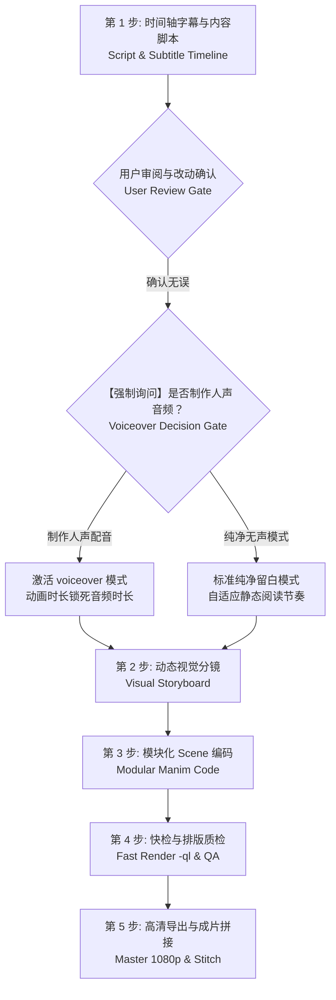

# Manim 数学视频全流程制作指南 (Manim Video Skill)

## 适用场景

当用户提出以下需求时加载并执行此 Skill：
- **制作数学可视化视频**：微积分、线性代数、初高等几何、概率统计、数论或物理数学动画。
- **教学/科普视频制作**：需要将抽象晦涩的数学公式转化为 3Blue1Brown 风格直观动画。
- **Manim 代码编写与调试**：编写高质量、防出界、中文友好的 Manim 场景脚本并渲染导出。

---

## ⚡ 核心哲学：五步闭环制作工作流

制作优质数学视频的核心在于：**“脚本为纲、用户门控、分镜定局、模块解耦、快检精修”**。



### 第 1 步：制作时间轴字幕与内容脚本（【强制】用户审核门控）
> ⚠️ **硬性红线**：严禁在未输出时间轴字幕脚本、或用户尚未确认的情况下直接开始编写 Manim 代码！
1. 确定视频主题、受众与 **1 个核心 Aha! 顿悟点**。
2. 使用 `templates/script_timeline_template.md` 编制逐幕时间轴表格，包含：
   - **时间戳预估**（如 00:00 - 00:15）
   - **口播台词 / 底部字幕**（自然口语化教学文本）
   - **对应视觉画面与动态行为**（几何形变、公式演化、色彩标记）
3. **输出给用户审阅**：明确提示用户检查台词逻辑、时长节奏与画面设想，并支持用户直接提出改动。
4. **用户确认无误后**，方可进入后续制作！

### 第 1.5 步：【强制询问】是否制作真人质感配音频道 (Audio Decision Gate)
> 🎙️ **必须向用户发起明确提问**：
- **询问内容**：“台词与脚本已确认。请问本视频是否需要生成真人质感 TTS 语音配音（微软云希沉稳男声 / 晓晓知性女声）？还是保持纯净无声教学模式？”
- **若用户选择生成人声**：在 Scene 中声明 `ENABLE_VOICEOVER = True`，使用 `with self.voiceover("...") as tracker:`，将动画时长与实际音频物理时长 `tracker.duration` 毫秒级锁死，并在导出时调用 `AudioEngine` 混入有声成片！
- **若用户选择纯净无声**：保持 `ENABLE_VOICEOVER = False`，动画时长按舒适阅读节奏自动计算。

### 第 2 步：动态视觉分镜设计 (Visual Storyboard)
1. 基于用户确认的脚本，细化具体的坐标布局与视觉锚点。
2. 拆分为 **3 ~ 5 个独立分幕 (Scenes)**，每幕独立为一个 Scene 类。
3. 严格规划屏幕空间（左侧几何、右侧公式、顶部标题、底部字幕）。

### 第 3 步：模块化 Manim 编码
1. **基类与运镜选择**：
   - 常规静态机位：继承 `BaseMathScene`；
   - 电影级推拉摇移（纪录片质感）：继承 `MovingCameraMathScene`，使用 `camera_zoom_to()`、`camera_pan_to()`、`camera_reset()` 引导视线。
2. **全局多主题一键换肤**：
   - 场景内直接指定 `DEFAULT_THEME = "claude_light"` 或 `"3b1b_dark"` 或 `"claude_dark"`；
   - 公式使用 `self.make_math()` 自动适配深浅背景反色，绝无白底白字隐形问题。
3. 依据审核确定的字幕内容调用 `self.set_caption("...")`，严丝合缝匹配台词。
4. 严格遵守安全视口（$X \in [-6.0, 6.0]$，$Y \in [-3.2, 3.2]$）。
5. 关键动画后设置合理的停顿（`self.pause(1.2)`），符合人类心智吸收节奏。

### 第 4 步：快检预览与自动化排版质检 (Fast QA)
1. 使用低画质极速渲染单幕（只需 2~5 秒）：
   ```bash
   python -m manim render scene_01.py Scene01Intro -ql
   ```
2. 或输出最后一帧验证排版重叠：
   ```bash
   python -m manim render -s scene_01.py Scene01Intro
   ```
3. 质检检查项：文字出界切边、旧图层未清理、动画怪异撕裂。

### 第 5 步：高清全量导出与一键拼接 (Master & Stitch)
1. 使用 `render_manager.py` 一键全量高清渲染并无损拼接：
   ```bash
   python skills/manim-video/scripts/render_manager.py --action pipeline --quality h --scenes scene_01.py:Scene01Intro scene_02.py:Scene02Proof --output my_math_video.mp4
   ```
2. 得到最终完整成片。

---

## 🔴 严格规则与防御准则 (Must Follow)

0. **【首要硬规则】脚本未审不写代码**：在开始写任何 Manim 代码之前，必须先制作时间轴字幕与内容脚本给用户审核，用户确认无误后方可推进。
0.5. **【硬规则·音频决策门控】时间轴过审后必须询问是否制作人声音频**：在时间轴脚本审核通过后，必须向用户明确询问：“*请问本视频是否需要生成真人质感 TTS 语音配音？还是保持纯净无声教学模式？*” 严禁未经询问擅自决定有声或无声。
1. **禁止把长视频写在单个 Scene 里**：必须解耦为 `scene_01.py`, `scene_02.py`... 独立类，便于快速微调单个分幕。
2. **禁止纯黑背景**：使用现代深色背景 `#121417`，避免视神经疲劳。
3. **中文排版首选 `Text`**：由于 LaTeX 中文配置各异，中文字幕与解说文本强制使用 `Text(..., font="Microsoft YaHei")`。
4. **公式严禁溢出**：长公式渲染后必须检查宽度，必要时调用 `formula.scale_to_fit_width(10)`。
5. **动态几何用 `ValueTracker`**：切线、动点、变参一律用 `ValueTracker` + `always_redraw` 驱动，杜绝每帧重复创建对象。
6. **环境依赖自检**：在执行前可随时运行 `python skills/manim-video/scripts/check_env.py` 诊断环境。

---

## 🛠️ 工具箱资源索引

- **通用基类 (7大美学主题、电影级运镜、3D HUD 与 voiceover 语画同步)**：[base_scene.py](file:///d:/数学教学/数学视频/mathvideo-skill/skills/manim-video/templates/base_scene.py)
- **电影级着色与光效材质引擎 (GlowEngine, AhaGlow, ParticleStreamRig)**：[visual_fx.py](file:///d:/数学教学/数学视频/mathvideo-skill/skills/manim-video/templates/visual_fx.py)
- **声音设计与语音合成引擎**：[audio_engine.py](file:///d:/数学教学/数学视频/mathvideo-skill/skills/manim-video/templates/audio_engine.py)
- **高阶数学 Rig 交互装置与 3D 曲面组件库**：[math_rigs.py](file:///d:/数学教学/数学视频/mathvideo-skill/skills/manim-video/templates/math_rigs.py)
- **智能排版与包围盒碰撞重叠检测器**：[layout_guard.py](file:///d:/数学教学/数学视频/mathvideo-skill/skills/manim-video/templates/layout_guard.py)
- **时间轴与字幕审核模板**：[script_timeline_template.md](file:///d:/数学教学/数学视频/mathvideo-skill/skills/manim-video/templates/script_timeline_template.md)
- **分镜设计模板**：[storyboard_template.md](file:///d:/数学教学/数学视频/mathvideo-skill/skills/manim-video/templates/storyboard_template.md)
- **环境诊断工具**：[check_env.py](file:///d:/数学教学/数学视频/mathvideo-skill/skills/manim-video/scripts/check_env.py)
- **毫秒级单帧切片质检工具**：[fast_inspector.py](file:///d:/数学教学/数学视频/mathvideo-skill/skills/manim-video/scripts/fast_inspector.py)
- **交互式 Web 故事板看板生成器**：[storyboard_generator.py](file:///d:/数学教学/数学视频/mathvideo-skill/skills/manim-video/scripts/storyboard_generator.py)
- **批量渲染拼接器**：[render_manager.py](file:///d:/数学教学/数学视频/mathvideo-skill/skills/manim-video/scripts/render_manager.py)
- **审美与色彩指南**：[color_and_typography.md](file:///d:/数学教学/数学视频/mathvideo-skill/skills/manim-video/references/color_and_typography.md)
- **避坑指南**：[common_pitfalls.md](file:///d:/数学教学/数学视频/mathvideo-skill/skills/manim-video/references/common_pitfalls.md)
- **常用数学动画模式**：[math_animation_patterns.md](file:///d:/数学教学/数学视频/mathvideo-skill/skills/manim-video/references/math_animation_patterns.md)
